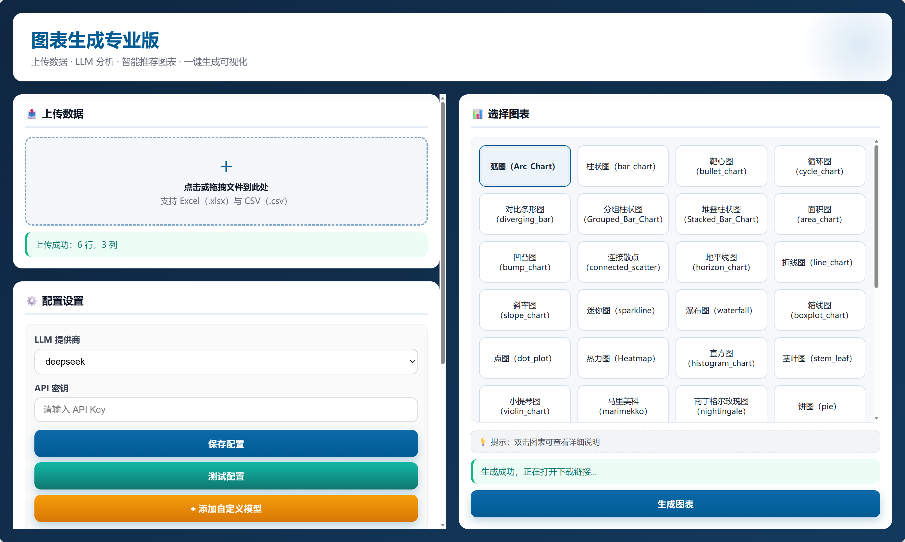
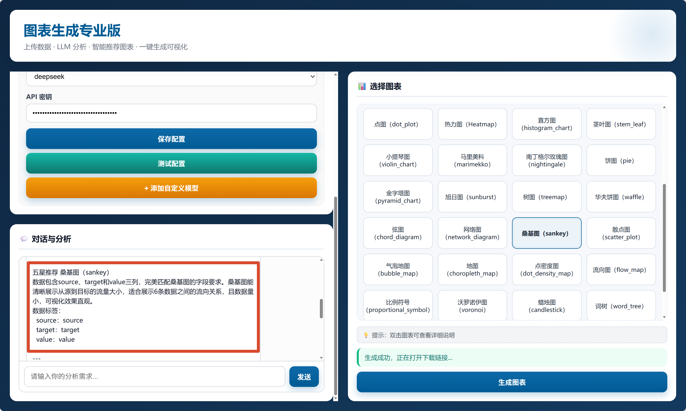
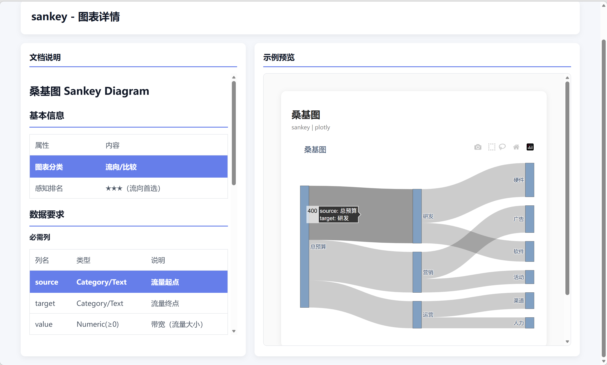
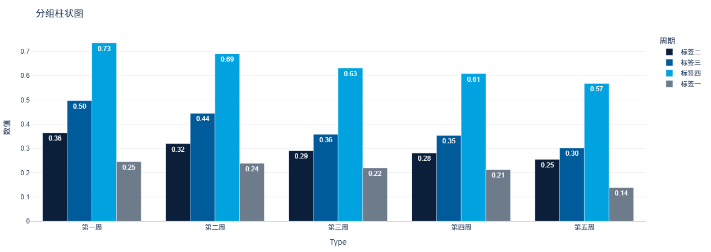

# VizNDatPilot AI

[](#)
[](#)
[](#)
[](#)
[](#)

> 上传表格，先做数据体检，再推荐并生成交互式图表。  
> Upload a table, run a data health check, then recommend and generate interactive charts.

---

## 目录

- [项目简介](#项目简介)
- [功能特性](#功能特性)
- [截图](#截图)
- [快速开始](#快速开始)
- [项目结构](#项目结构)
- [数据体检报告](#数据体检报告)
- [图表系统](#图表系统)
- [LLM 配置](#llm-配置)
- [支持的图表类型](#支持的图表类型)
- [使用流程](#使用流程)
- [常见问题](#常见问题)
- [许可证](#许可证)

---

## 项目简介

**VizNDatPilot AI** 读取 CSV / Excel，做两件事：

1. **数据体检**：程序按原始表计算质量分数和问题清单，模型只写说明，不编造数字。
2. **图表生成**：根据字段和需求推荐图表，并导出可交互的 Plotly HTML。

当前报告只生成数据体检报告，不生成业务分析报告。

---

## 功能特性

### 数据上传

- 支持 `CSV`、`Excel (.xlsx / .xls)`，单文件上限 50 MB
- 上传后识别字段，供推荐和体检使用

### 数据体检

- 体检对象是上传的原始表，计分前不改写数据
- 六个维度：完整性、唯一性、有效性、一致性、及时性、结构
- 综合分 0–100，等级 A / B / C / D；存在严重问题（P0）时综合分封顶 49
- 没有日期列时，及时性为 N/A，不计入综合分
- 未声明主键时，不把标识列重复当成主键错误
- 模型叙事经过数字白名单校验；校验失败或模型不可用时，改用程序模板
- 页面展示检查规则、问题、字段明细和解读；悬停维度名称可查看该指标的含义

指标定义见 [docs/prd-data-health-report.md](docs/prd-data-health-report.md)。

### 图表推荐与生成

- 图表目录来自 `charts/registry.py`，当前 41 种
- LLM 给出推荐理由和字段映射；也可在图表网格中直接选择
- 配色方案：McKinsey Blue、BCG Green、Bain Red、EY Yellow
- 生成结果为交互式 HTML，可下载

---

## 截图

### 首页



### LLM 推荐结果



### 图表详情



### 生成结果



---

## 快速开始

### 环境

- Python 3.8+
- pip

### 安装并启动

```bash
pip install -r requirements.txt
python app.py
```

Windows 可双击 `start.bat`。脚本会创建 `.venv`、安装依赖，并在 5017 端口启动 `app.py`。

浏览器打开：`http://localhost:5017`

---

## 项目结构

```text
├── app.py                     # Flask 入口：页面、上传、推荐、出图、体检
├── chart_generate.py          # 按图表模块生成 Plotly HTML
├── requirements.txt
├── start.bat                  # Windows 一键安装并启动
├── core/
│   ├── health_report.py       # 体检报告组装与模型叙事
│   ├── quality_ledger.py      # 质量指标、打分、问题清单
│   ├── fact_extractor.py      # 字段角色识别
│   ├── number_whitelist.py    # 叙事数字白名单
│   ├── rounding.py            # 四舍五入
│   └── data_profiler.py       # 字段画像（推荐与出图使用）
├── utils/
│   └── validator.py           # 数据清洗与校验
├── LLM/
│   ├── llm_recommender.py     # 图表推荐
│   └── llm_config_manager.py  # 模型配置
├── charts/
│   ├── registry.py            # 图表目录（唯一来源）
│   └── <chart_id>/            # 各图表实现
├── templates/
│   ├── index.html             # 主页面
│   └── chart-detail.html      # 图表详情页
├── docs/
│   └── prd-data-health-report.md
├── uploads/                   # 上传文件
└── outputs/                   # 生成的图表
```

---

## 数据体检报告

`POST /api/report` 只接受 `report_type=health`。可选 `primary_key`（列名数组）用于检查编号是否重复。

程序负责：

- 缺失、整行重复、格式解析、离群、写法不一致、日期跨度、列名结构
- 六维分数、综合分、等级和问题清单
- 检查规则与字段解读中的数字

模型只补充不含新数字的说明。白名单不通过时丢弃模型文本，改用程序模板。

空单元格，以及取值为「无」「未知」「N/A」等伪装空值，计入未填。明显偏大或偏小的数值只提示核对，不直接认定为填错。

---

## 图表系统

图表实现和目录分开。新增一种图表：

1. 在 `charts/<new_chart>/` 添加 `chart.py`，并建议附上 `README.md`
2. 在 `charts/registry.py` 登记 `chart_id`、名称、类别和字段要求
3. 重启服务。前端列表从 `/api/charts` 读取，不必改页面逻辑

---

## LLM 配置

页面「配置设置」中选择提供商并保存 API Key，也可添加自定义 OpenAI 兼容接口。

| 提供商 | 默认接口 | 环境变量 |
|---|---|---|
| DeepSeek | `https://api.deepseek.com` | `DEEPSEEK_API_KEY` |
| MiniMax | `https://api.minimax.chat/v1` | `MINIMAX_API_KEY` |
| OpenAI 及自定义兼容接口 | 由配置指定 `base_url` 与模型名 | 在页面填写 API Key |

体检报告在模型不可用时仍会生成，叙事改为程序模板。图表推荐依赖可用的模型配置。

Windows：

```bash
set DEEPSEEK_API_KEY=your_api_key
set MINIMAX_API_KEY=your_api_key
```

macOS / Linux：

```bash
export DEEPSEEK_API_KEY=your_api_key
export MINIMAX_API_KEY=your_api_key
```

---

## 支持的图表类型

目录以 `charts/registry.py` 为准，当前 41 种。

### 对比类 COMPARING

- `Marimekko_ABS` 马里美科（绝对值）
- `Marimekko_PCT` 马里美科（百分比）
- `Bar_Chart` 柱状图
- `Grouped_Bar_Chart` 分组柱状图
- `Stacked_Bar_Chart` 堆叠柱状图
- `Diverging_Bar_Chart` 对比条形图
- `Dot_Plot` 点图
- `Waffle` 华夫格
- `Bullet_Chart` 靶心图
- `Sankey_Chart` 桑基图
- `Heatmap` 热力图
- `Waterfall` 瀑布图

### 时间趋势类 TIME

- `Line_Chart` 折线图
- `Circular_Line_Chart` 圆形折线图
- `Slope_Chart` 斜率图
- `Sparkline` 迷你图
- `Bump_Chart` 凹凸图
- `Cycle_Chart` 周期图
- `Area_Chart` 面积图
- `Stacked_Area_Chart` 堆叠面积图
- `Horizon_Chart` 地平线图
- `Connected_Scatter` 连线散点图

### 分布类 DISTRIBUTION

- `Histogram_Pareto_chart` 直方图与帕累托图
- `Pyramid_Chart` 金字塔图
- `Error_Bar_Chart` 误差条形图
- `Box-and-Whisker_Plot` 箱线图
- `Violin_Chart` 小提琴图
- `Ridgeline_Plot` 山脊线图
- `Beeswarm_Plot` 分簇散点图

### 地理类 GEOSPATIAL

- `Dot_Density_Map` 点密度地图
- `Choropleth_Map` 面量图

### 关系类 RELATIONSHIP

- `Scatter_Plot` 散点图
- `Bubble_Plot` 气泡图
- `Chord_Diagram` 弦图
- `Arc_Chart` 弧图
- `Network_Diagram` 网络图
- `Parallel_Coordinates_Plot` 平行坐标图

### 占比图 PART-TO-WHOLE

- `Treemap` 矩形树图
- `Sunburst_Diagram` 旭日图
- `Nightingale_Chart` 南丁格尔玫瑰图
- `Pie_Chart` 饼图

---

## 使用流程

1. 上传 CSV 或 Excel
2. 在配置里选择模型并保存 API Key
3. 点击「生成体检报告」，查看分数、检查规则、问题和字段
4. 输入分析需求获取图表推荐，或直接在图表网格中选择
5. 生成并下载 HTML 图表

---

## 常见问题

### 推荐结果为空

检查 API Key、网络和模型服务。确认上传文件非空，且字段可以被读取。

### 图表生成失败

字段类型需要满足该图表在 registry 中的要求。查看运行 `app.py` 的终端日志。

### 体检报告没有模型说明

模型调用失败时，报告仍会返回。分数、问题和检查规则由程序写出，说明改用模板。

### 文档里的图表和页面不一致

以 `charts/registry.py` 为唯一目录。页面通过 `/api/charts` 读取这份目录。

---

## 许可证

[Apache License 2.0](LICENSE)。
